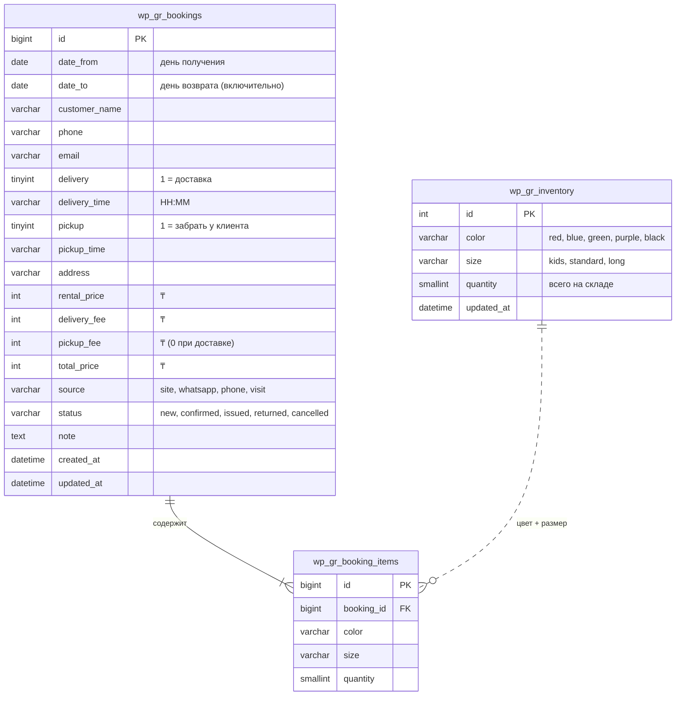

# Gown Rental — прокат мантий выпускников

Плагин WordPress для сайта проката бакалаврских мантий **Mantiya Shymkent Prokat**.
Клиент выбирает даты, цвета, размеры и количество — сайт сразу проверяет, есть ли
мантии на эти даты, и принимает бронь. Администратор ведёт брони и склад в админке.

> Всё, что относится к прокату (склад, брони, проверка наличия, страницы сайта),
> написано в этом плагине. WordPress даёт админку, страницы, меню и вход; тема —
> Kadence; форма «Напишите нам» — Contact Form 7.

---

## Возможности

**Для клиента**

- Главная: выбор дат прямо на первом экране, сразу видно, какие цвета свободны.
- Каталог: 5 цветов × 3 размера, в одной брони — сколько угодно цветов и размеров.
- Наличие по датам: клиент видит только «в наличии / нет / столько нет» — точные остатки скрыты.
- Получение: самовывоз (адрес, часы, ссылка на 2ГИС) или доставка туда и обратно за одну сумму,
  бесплатно от 20 мантий.
- Расчёт стоимости на лету, согласие на обработку персональных данных, письмо-подтверждение.
- Страницы «Условия аренды», «Нам доверяют», «Контакты», «Политика конфиденциальности».

**Для администратора** (меню «Прокат мантий»)

- Брони: список с фильтрами, смена статуса прямо в списке, создание и редактирование
  (например, по заявке из WhatsApp), удаление.
- Склад: сколько мантий каждого цвета и размера всего и сколько занято сегодня.
- Настройки: цена за сутки, стоимость доставки, порог бесплатной доставки, адрес самовывоза,
  часы работы, ссылка на 2ГИС, фото цветов для каталога.

---

## Как устроена проверка наличия

Это главное правило проката.

1. Период аренды **включает** день получения и день возврата (1–3 марта = 3 дня).
2. День возврата занят, **со следующего дня** мантия снова свободна. Буферных дней на чистку нет.
3. Мантии занимают только брони со статусами **Новая, Подтверждена, Выдана**.
   «Возвращена» и «Отменена» не занимают.
4. Для каждого цвета и размера считается **пиковая занятость** — максимум по дням периода:

   ```
   свободно = остаток на складе − max( занято в день d ),  d ∈ [получение … возврат]
   ```

5. Бронь с несколькими позициями принимается **целиком или никак**: если не хватает хотя бы
   одной позиции, ничего не сохраняется.
6. При редактировании бронь не считает занятыми свои же мантии.
7. Смена статуса на «активный» (например, «Отменена» → «Подтверждена») заново проверяет наличие.
8. **Двойные брони исключены:** проверка и запись идут под блокировкой MySQL
   `GET_LOCK('gr_booking_lock')`, поэтому два клиента не могут одновременно забрать последние мантии.
9. Не у всех цветов есть все размеры (у фиолетового нет детского) — `gr_color_sizes()`.

---

## База данных

Три собственные таблицы (префикс `wp_`).



- `wp_gr_inventory` — уникальный ключ `(color, size)`, одна строка на комбинацию.
- `wp_gr_bookings` — индексы по датам и статусу (их использует проверка наличия).
- `wp_gr_booking_items` — «2 красных детских + 3 синих длинных» = две строки одной брони.
- Суммы хранятся в брони на момент оформления: если цена потом изменится, старые брони не пересчитаются.
- Таблицы создаются и обновляются автоматически (`dbDelta`) при смене версии плагина.

---

## Установка

1. WordPress 6.5+ (проверено на 7.1), PHP 7.4+ (проверено на PHP 8.5), MySQL 8 / MariaDB 10.6+.
2. Скопировать папку `gown-rental` в `wp-content/plugins/` и активировать плагин —
   таблицы и начальные настройки создадутся сами.
3. Создать страницы и вставить шорткоды:

   | Страница | Шорткод |
   |---|---|
   | Главная | `[gown_landing]` |
   | Каталог | `[gown_catalog]` |
   | Условия аренды | `[gown_terms]` |
   | Нам доверяют | `[gown_trust]` |
   | Контакты | `[gown_contacts]` (внутри — форма Contact Form 7) |
   | Политика конфиденциальности | `[gown_privacy]` |

4. «Прокат мантий → Склад» — указать количество мантий. «Прокат мантий → Настройки» — цены, адрес, фото.

---

## Структура

```
gown-rental/
├── gown-rental.php          точка входа: версия, подключение файлов
├── includes/
│   ├── config.php           справочники (цвета, размеры, статусы), цены, расчёт суммы
│   ├── install.php          таблицы, миграции, значения по умолчанию
│   ├── inventory.php        склад и проверка наличия (пиковая занятость)
│   ├── bookings.php         чтение, проверка, сохранение и удаление броней, блокировка
│   ├── emails.php           письма администратору и клиенту
│   ├── public.php           AJAX сайта: наличие/стоимость и отправка брони
│   ├── catalog-template.php разметка каталога
│   ├── landing.php          главная страница
│   ├── pages.php            условия, контакты, политика конфиденциальности
│   └── trust.php            «Нам доверяют» и полоса логотипов на главной
├── admin/                   страницы админки: брони, склад, настройки
├── public/                  CSS, JS и изображения сайта
├── tests/run-tests.php      автотесты
└── docs/SPEC.md             подробное описание правил и интерфейсов
```

---

## Безопасность

- Все запросы к базе — через `$wpdb->prepare`, все входные данные очищаются (`sanitize_*`), весь вывод экранируется (`esc_*`).
- Формы и AJAX защищены nonce; действия админки требуют права `manage_options`.
- Сервер всегда перепроверяет бронь сам — данным из браузера не доверяет (статус и источник брони с сайта задаёт сервер).
- Клиенту не отдаются точные остатки склада — только «есть / нет».
- Ловушка для спам-ботов (скрытое поле) в форме брони.
- Бронь с сайта без согласия на обработку персональных данных не принимается.

---

## Тесты

```bash
cd app/public
php wp-content/plugins/gown-rental/tests/run-tests.php
```

40 проверок: расчёт дней и сумм, порог бесплатной доставки, пиковая занятость и день возврата,
перепроверка при смене статуса, валидация, ответ сайта без чисел, права и nonce в AJAX админки,
согласие на обработку данных. Тесты используют даты в 2030 году и удаляют за собой всё, что создали.
